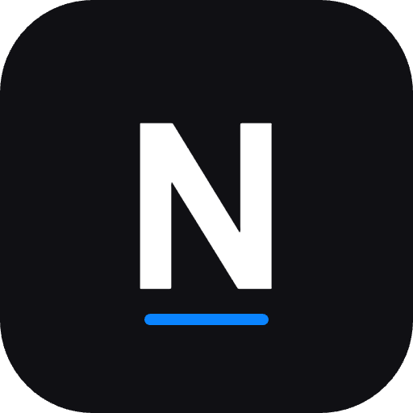

<div align="center">



# Noobs Screener

**A one-page Indian stock screener that runs as a Windows desktop app *or* a static website.**

Live NSE prices · financials · ratios · shareholding · peer comparison · company news · valuation history · screen backtesting

[](https://github.com/udyawarahmad/noobs-screener/actions/workflows/build-exe.yml)
[](https://github.com/udyawarahmad/noobs-screener/releases/latest)
[](LICENSE)

</div>

---

## Contents

- [What this is](#what-this-is)
- [Feature tour](#feature-tour)
- [Quick start](#quick-start)
- [Requirements](#requirements)
- [Project structure](#project-structure)
- [How the data works](#how-the-data-works)
- [Caching](#caching)
- [Where your data is stored](#where-your-data-is-stored)
- [The Time Machine](#the-time-machine-valuation-history--backtesting)
- [The stock screener](#the-stock-screener)
- [News](#news-free-and-keyless)
- [Performance notes](#performance-notes)
- [Tests](#tests)
- [Building the Windows app](#building-the-windows-app)
- [Automated builds with GitHub Actions](#automated-builds-with-github-actions)
- [Hosting the website version](#hosting-the-website-version)
- [Troubleshooting](#troubleshooting)
- [Known limits](#known-limits)
- [Versioning and releases](#versioning-and-releases)
- [Version history](#version-history)
- [Data sources and attribution](#data-sources-and-attribution)
- [License](#license)

---

## What this is

Noobs Screener puts everything you would normally open five browser tabs for onto **one page** per stock:

prices and charts, annual and quarterly financials, balance sheet, cash flow, ratios, shareholding, peers, pros/cons, filings, and news — plus a screener that filters a curated NSE universe on live fundamentals, a valuation-history card, and a backtester for your screens.

It is a **plain static web app** (`renderer/`) wrapped in a thin **Electron** shell (`main.js`). There is no build step, no bundler, no framework, and no backend you have to run or pay for. The same `renderer/` folder works three ways:

| Delivery | What runs | Networking | Persistence |
|---|---|---|---|
| **Installed `.exe`** | Electron | Requests proxied through the main process — no CORS at all | Files in `%APPDATA%\Noobs Screener\` |
| **Portable `.exe`** | Electron | Same as above | Files in `Noobs-Screener-Data\` next to the exe |
| **Website** (`renderer/` folder) | Any static host | Direct `fetch`, with a public CORS proxy as fallback | Browser `localStorage` |

> **Not investment advice.** Prices are indicative and may be delayed. Verify anything that matters against the exchange or the company's own filings.

---

## Feature tour

### Per stock

| Card | What's in it |
|---|---|
| **Overview** | Symbol, name, sector, consolidated/standalone badge, live price and day change, 52-week range bar, day high/low/open/volume, price chart with 1M / 6M / 1Y / 3Y / 5Y ranges, 50 & 200 DMA, volume bars and a hover/touch tooltip |
| **Valuation History** | Today's P/E and P/B against the stock's own multi-year history — percentile, median, 20th–80th percentile band, and a chart of the series |
| **Pros & Cons** | The published checklist strengths and red flags |
| **Latest News** | Recent headlines that mention *this* company, from free RSS feeds |
| **Peer Comparison** | Live peer metrics as published, clickable into any covered peer |
| **Quarterly Results** | Last 8 quarters with year-on-year growth under key lines |
| **Profit & Loss** | Annual + TTM statements with a Sales / Net-profit mini chart |
| **Balance Sheet** | Where the money comes from and where it sits |
| **Cash Flows** | Operating, investing and financing movement |
| **Ratios** | Year-wise ratios as published |
| **Shareholding** | Promoter / FII / DII / public / others across the latest quarters, with a stacked chart |
| **Filings & Links** | Company site, screener.in page, NSE quote, BSE quote, Yahoo quote — all open in your real browser |
| **About** | Company profile plus quick facts (sector, promoter holding, listed-on links) |

### Market-wide

- **Index strip** — NIFTY 50, SENSEX, NIFTY BANK, USD/INR and Gold, live. Click any of them to load its chart and stats into the Overview.
- **Universal search** — the curated universe appears instantly; anything else is looked up live on screener.in's search API, so you can open *any* listed Indian company, not just the 163 in the list.
- **Screener** — 11 filters, 13 sortable columns, 7 one-click presets, a human-readable query preview, CSV export and a backtester.
- **Watchlist** — star any stock (including ones you found via universal search); it survives restarts.
- **Light / dark theme**, remembered between sessions.
- **PWA install** — the website build can be added to a phone's home screen and run full-screen.

---

## Quick start

### Option A — download the app (no tooling at all)

Grab the newest file from the [Releases page](https://github.com/udyawarahmad/noobs-screener/releases/latest):

| File | Use it when |
|---|---|
| `Noobs-Screener-Setup-<version>.exe` | **Best everyday choice.** Normal install, Start-menu shortcut, uninstaller. Fastest startup. |
| `Noobs.Screener-<version>-win.zip` | You want no installer. Unzip once, run `Noobs Screener.exe` inside. |
| `Noobs-Screener-Portable-<version>.exe` | USB stick / one-file carry. See the startup caveat below. |

> The executables are **not code-signed**, so Windows SmartScreen may show *"Windows protected your PC"* the first time. Click **More info → Run anyway**.

**Why the portable exe opens slowly:** it unpacks ~250 MB to `%TEMP%` on *every* launch. That is inherent to the portable format, not a bug. Use the installer or the zip for daily driving.

### Option B — run from source

```bash
git clone https://github.com/udyawarahmad/noobs-screener.git
cd noobs-screener
npm install
npm start
```

`npm start` launches Electron with the real app window.

### Option C — just the website

The `renderer/` folder is the whole web app. Serve it with anything:

```bash
npx serve renderer        # or: python3 -m http.server -d renderer 8080
```

Open the URL and it works. On the open web, screener.in pages come through a public CORS proxy (see [How the data works](#how-the-data-works)), so the desktop build is snappier and more reliable — but the website needs no install.

---

## Requirements

| Task | Needs |
|---|---|
| Running the app from source | **Node.js 18+** (any LTS) |
| Running the **full** test suite | **Node.js 22+** — the renderer smoke test uses jsdom, which needs a modern Node. On older Node that one file prints a `skipped` notice instead of failing. |
| Building the Windows `.exe` on Windows | Node 18+, nothing else |
| Building the Windows `.exe` on macOS/Linux | Node 18+ **and Wine** — or just push a tag and let GitHub Actions do it |
| Running the website | Any static host. No Node, no build step. |

Dependencies are deliberately tiny:

```jsonc
"devDependencies": {
  "electron":         "^33.2.0",   // the desktop shell
  "electron-builder": "^25.1.8",   // packaging into .exe
  "jsdom":            "^31.0.1"    // only for the end-to-end test
}
```

There are **no runtime dependencies** in `dependencies`. Nothing is bundled or transpiled.

---

## Project structure

```text
noobs-screener/
├── main.js                     Electron main process: window, fetch proxy, IPC, disk store wiring
├── main-store.js               Pure-Node persistent store (state.json + cache/); no Electron imports,
│                               so it is unit-testable on its own
├── preload.js                  contextBridge: exposes electronFetch + nsStore to the page safely
├── assets/
│   ├── icon.ico                Installer / window icon for Windows
│   └── icon.png                Window icon, README logo
├── renderer/                   ← the entire app; host this folder to run it as a website
│   ├── index.html              All markup, in one page
│   ├── theme.css               Design system: CSS custom properties, light + dark, responsive
│   ├── store.js                PStore: disk bridge on desktop, localStorage on the web
│   ├── universe.js             The curated universe + sector list + symbol helpers
│   ├── live.js                 Fetch layer, Yahoo price history, screener.in parsers, cache TTLs
│   ├── news.js                 RSS feeds, XML parsing, strict relevance matching
│   ├── valuation.js            Valuation history + backtest maths (pure functions)
│   ├── app.js                  Rendering, charts on canvas, screener, watchlist, exports, init
│   ├── manifest.webmanifest    PWA manifest
│   └── icons/                  PWA icons (192, 512)
├── test/
│   ├── persistence.test.js     Disk store + renderer fallback + the old quota bug (13 tests)
│   ├── news.test.js            RSS parsing, feed fallback, relevance rules (12 tests)
│   ├── valuation.test.js       Valuation + backtest, incl. fuzzing (22 tests)
│   └── renderer.smoke.test.js  Boots the real index.html in jsdom (15 tests)
├── .github/workflows/
│   └── build-exe.yml           Windows CI: test → build → upload artifacts + Release assets
├── package.json                Scripts, electron-builder config
└── LICENSE                     MIT
```

Roughly **5,000 lines** of hand-written JavaScript/CSS/HTML across the app and tests.

---

## How the data works

Two sources, both public, both parsed live in your browser:

| Data | Source | Notes |
|---|---|---|
| Prices, OHLCV, 52-week range, indices | **Yahoo Finance** chart API | 5 years of daily closes, split/bonus adjusted |
| Financials, ratios, shareholding, peers, pros/cons, profile | **screener.in** company pages | Parsed from HTML with `DOMParser`; consolidated figures preferred, standalone as fallback |
| Universal search | screener.in search API | Lets you open companies outside the curated list |
| News | Google News / Bing News / Yahoo Finance RSS | Free, keyless |

### The three-tier fetch strategy

Every request goes through `httpText()` / `httpJSON()` in `renderer/live.js`, which tries in order and stops at the first success:

1. **`window.electronFetch`** — in the desktop app, the request is made by the Electron **main process** via `net.fetch`. Node has no CORS model, so this always works.
2. **Direct `fetch`** — works everywhere for Yahoo (it sends permissive CORS headers), and for screener.in when the browser/extension allows it.
3. **Public CORS proxy** — `https://corsproxy.io/?url=…`, so the plain-website build still functions.

Each attempt is wrapped in a 30-second `AbortController` timeout, so one slow host can never stall the page.

### Parser resilience

The screener.in parser does not assume a fixed layout:

- Rows are found by **label** with fallbacks (`Sales` / `Total Income` / `Revenue` / `Interest Earned`; `Borrowings` **and** the singular `Borrowing` that banks use).
- Columns are matched by **label**, not position, and sorted by date — so it works whether the source lists oldest-first or newest-first.
- `TTM` and other non-month columns are recognised and handled separately.
- Symbol fallbacks exist for renamed or delisted tickers (`ALT_SLUG`, `ALT_Y`, NSE `.NS` → BSE `.BO`).
- Consolidated is requested first (`/consolidated/`), then standalone (`/`).

### Security posture

The Electron shell is locked down the way you would want for an app that renders third-party HTML:

```js
webPreferences: { contextIsolation: true, nodeIntegration: false }
```

- The page can only reach the main process through the small `nsStore` / `electronFetch` surface in `preload.js`.
- `setWindowOpenHandler` **denies** every new window and instead hands `http(s)` URLs to `shell.openExternal`.
- `will-navigate` is prevented for `http(s)` URLs, so a stray link can never navigate the app window away.

---

## Caching

Price *history* is fetched once a day; the price you are *looking at* refreshes every couple of minutes while the market is open.

| Data | TTL | Cache key |
|---|---|---|
| Company page (financials, ratios, shareholding, peers, pros/cons) | **7 days** | `co:<SYMBOL>` |
| Price history (the multi-year `pts` series) | **1 day** | `ch3:<YAHOO_SYMBOL>` |
| **Displayed quote** (hero, index strip, watchlist) | **2 min** while the NSE is open (9:15–15:30 IST, Mon–Fri), **15 min** otherwise | same chart records, re-fetched on view and every 2 min |
| News | **45 minutes** (a *miss* is remembered for only 5 minutes, so a flaky network recovers) | `news:<SYMBOL>` |

Clever bits worth knowing:

- **"Live" means live.** A window left open from 9:30 to 15:30 keeps ticking: the hero, index strip and watchlist re-confirm their quotes every 2 minutes during market hours (and the freshness stamp says exactly *when* — no bare "live" claims). Screener rows and backtests stay on the 1-day history cache so they never trigger a 163-stock refetch storm.
- **Refresh** clears the *data cache only*. Your watchlist and theme are never touched.
- The news empty-state is cached briefly on purpose — otherwise the card would hammer three feeds on every open.
- Legacy cache keys keep the old `screenone` prefix so watchlists from earlier versions keep working.
- Cache keys contain characters Windows forbids in file names (`:` in `ch3:RELIANCE.NS`), so the disk store sanitises the key and appends a base-36 hash; a store record also carries its original key, so a hash collision can never hand back the wrong data.

---

## Where your data is stored

The watchlist, theme and data cache are written to **real files** on desktop. This is a deliberate fix, not a preference — see [Version history](#version-history).

| Build | Location |
|---|---|
| **Portable `.exe`** | `Noobs-Screener-Data\` next to the executable (falls back to `%APPDATA%` if that folder is read-only, e.g. a locked USB stick) |
| **Installed app** | `%APPDATA%\Noobs Screener\` |
| **Website** | Browser `localStorage` |

Inside the folder:

```text
Noobs-Screener-Data/
├── state.json          watchlist + theme (tiny, always writable, written atomically)
└── cache/
    ├── co_RELIANCE.NS.1f2k3j.json
    ├── ch3_RELIANCE.NS.9x8y7z.json
    └── …                one JSON file per cached item
```

How the store behaves:

- **Atomic writes** — every file is written to `<name>.tmp` and then `rename`d, so a crash mid-write cannot corrupt state.
- **Debounced** — state writes ~300 ms after the last change, cache writes ~1.5 s after, and the timers are `unref`'d so they never keep the process alive. Everything is flushed on `before-quit` and `window-all-closed` too.
- **Bounded** — `trimCache()` runs once at startup; above **250 MB** it drops the oldest files down to 75% of the cap, so the folder can't grow without limit and startup is never stalled.
- **Per-item files** — changing one stock does not rewrite the whole cache.
- **Migration** — when 1.0.0's `%APPDATA%` profile exists, the portable build copies the old `Local Storage` folder across once so the previous watchlist can be imported. The renderer also migrates a `localStorage`-only watchlist into the disk store the first time it sees one.

The website build uses `localStorage` with the same API (`PStore`), so `app.js` never needs to know which one it is talking to.

---

## The Time Machine: valuation history + backtesting

Two things most free Indian screeners don't do. Both are computed from data the app already has — no extra keys, no backend. The maths lives in `renderer/valuation.js` as pure functions, which is why it can be tested numerically.

### 1. Is this stock cheap *for its own history*?

Every stock page shows P/E and P/B against that stock's own multi-year range:

- **Percentile verdict** — "cheaper than 78% of its history", not just a raw multiple.
- **Median** and the **20th–80th percentile band** (the "usual range").
- **A chart** of the full daily series with those bands drawn on it.
- A clear "not enough history" message instead of invented numbers.

### 2. Would your screen have actually worked?

**Backtest this screen** re-runs your *current* filters as of 1, 2 or 3 years ago, equal-weights everything that passed, holds to today, and reports:

| Metric | Meaning |
|---|---|
| Stocks passing | how many names the screen selected, out of the universe |
| CAGR | the equal-weight portfolio's annualised return |
| NIFTY CAGR | the same window on the NIFTY 50 (`^NSEI`) |
| vs NIFTY | alpha in percentage points |
| Max drawdown | worst peak-to-trough of the equity curve |
| Hit rate | share of picks that ended positive |
| Picks table | the best 12 names with their return, P/E *then* and ROE *then* — click a row to open the stock |

Results clear themselves the moment you change a filter, so you never read a stale backtest.

### How the numbers are produced

| Input | Source / rule |
|---|---|
| EPS, net profit, sales, book value | screener.in annual statements (~10 years) |
| Price series | Yahoo daily closes, split/bonus adjusted |
| "Known at the time" | a fiscal year counts from **year end + 90 days**, approximating Indian filing dates |
| Per-share history | *today's* share count (equity capital ÷ face value) — the same basis as adjusted prices |
| ROE | net profit ÷ (equity capital + reserves), from the statements |
| ROCE | the published ratio table, with an operating-profit ÷ (equity + borrowings) fallback |
| Dividends (historical yield) | dividend payout % × EPS ÷ price |
| Today's multiple | anchored to the P/E and book value the source publishes, so this card can never contradict the header |
| Rounding guard | the daily series is rescaled to meet today's published multiple only when the factor is plausible (0.5×–2×); otherwise left raw |
| Percentiles | need ≥ 20 valid samples; otherwise the card says so |

The charts and maths are validated against published screener.in figures, not just internal consistency — the test suite pins real numbers for TCS (book value ₹329, P/B 7.82×, EPS timeline 2015 ₹50.68 → TTM ₹142.64) and HDFC Bank (book value ₹391, P/E 16.48 vs a published 16.4).

### Honest limits

All of these are stated in the UI too:

- **Survivorship bias.** The backtest universe is *today's* curated list. Stocks that were dropped or delisted aren't there. Treat results as a sanity check on a screen, not proof.
- **Dividends are excluded** from returns.
- **Market cap uses today's share count**; genuine dilution is not retro-fitted.
- **~90-day reporting lag** is an approximation; real filing dates vary.
- **ROCE is not invented.** Banks have no published ROCE row, so the card shows `–`.
- **5 years is the limit** of the price history; 3-year backtests are the solid ones.

---

## The stock screener

The screener card filters the curated universe on live ratios.

**Universe:** 163 stocks across 36 sectors (the file holds 164 entries; one superseded pre-demerger Tata Motors row is skipped).

### Filters

| Filter | Meaning |
|---|---|
| Search | name or symbol |
| Sector | dropdown built from the universe |
| M.Cap above (₹ Cr) | minimum market capitalisation |
| P/E below | maximum price-to-earnings |
| ROE above % / ROCE above % | minimum profitability |
| Div. yield above % | minimum dividend yield |
| Debt/Equity below | maximum leverage |
| Sales growth 3Y above % / Profit growth 3Y above % | minimum 3-year CAGR |
| OPM above % | minimum operating margin |
| Watchlist only | restrict to starred names |

**Presets:** Large caps · High ROE (>20%) · High dividends · Low P/E (<20) · Almost debt-free · Fast growers · Reset.

### Table

Columns: Symbol · Company · CMP ₹ · M.Cap Cr · P/E · ROE% · ROCE% · Div% · D/E · SalesGr% · ProfitGr% · 1Y% · ★

- 13 sortable columns (click a header; click again to reverse).
- 15 rows per page with Prev/Next.
- Click any symbol to open that stock.
- The **query preview** shows your filters as readable text, and **Copy query** puts it on the clipboard.
- **Export results CSV** downloads `noobs_results.csv`. The header **Export** button downloads `<SYMBOL>_financials.csv` for the open stock.
- Missing values render as `…` while loading and `–` when genuinely unavailable — never as zero.

**Lazy loading:** the 163-stock bulk load is deferred until the screener card scrolls within 300 px of the viewport (or you touch a filter). Opening the app to look at one stock never triggers a 163-company download.

---

## News (free and keyless)

Each stock page has a **Latest News** card. Sources are public RSS feeds, tried in order until one returns *relevant* results:

| Order | Source | Feed |
|---|---|---|
| 1 | Google News | `news.google.com/rss/search?q="<company>" share OR stock&hl=en-IN&gl=IN` |
| 2 | Bing News | `www.bing.com/news/search?format=RSS&setmkt=en-IN` |
| 3 | Yahoo Finance | `feeds.finance.yahoo.com/rss/2.0/headline?s=<ticker>` |

No API key, no signup, no quota.

**Only related news is shown.** A headline is kept only if it contains one of:

1. the company's **full name** (minus filler words like *India*, *Limited*, *Industries*),
2. **every distinctive word** of the name (so "Power Grid" needs both *power* **and** *grid*),
3. the **ticker** as a whole word, or
4. a known **press short form** — `RIL`, `L&T`, `HUL`, `M&M`, `SBI`, `HDFC Bank`, `Sun Pharma`, and ~40 more.

Anything else is dropped. If nothing matches, the card says so — it never pads itself with generic market news. Headlines are de-duplicated by a normalised title, sorted newest first, capped at 12, and every link opens in your system browser.

---

## Performance notes

Startup was treated as a feature, not an afterthought:

- **Only the stock you open is fetched at startup.** The 163-stock screener load waits for the screener card to approach the viewport (`IntersectionObserver`, 300 px margin) or for you to touch a filter. (Your watchlist quotes load right away — a handful of requests, 3 at a time.)
- **Cache-first rendering.** Cached stocks paint straight from disk with no network round-trip, and the cache survives restarts.
- **No white flash.** The window is created with `show: false` and revealed on `ready-to-show`.
- **Cheaper paints on desktop.** The desktop build adds `body.native`, which swaps the sticky bars' `backdrop-filter` blur for solid surfaces — the single most expensive thing to repaint on Windows.
- **Parallel fetches.** Company data and price history for the open stock are requested together.
- **Batched table repaints.** During the bulk load, arriving stocks coalesce into at most a few repaints per second instead of one per stock.
- **Gentle concurrency.** Bulk financials load 3 at a time with a 250 ms gap and one retry; price history loads 6 at a time.
- **Live quote refresh.** The hero, index strip and watchlist re-confirm their quotes every 2 minutes while the NSE is open (and when the tab comes back into view), so a session left open all day never shows a frozen price. The refresh yields to the bulk load and sleeps when the tab is hidden.
- **Deferred index strip.** Rendered 250 ms after the base DOM so the stock hero paints first.
- **Canvas everywhere.** Charts are hand-drawn on `<canvas>` (no chart library), with `devicePixelRatio` scaling and pointer hover/touch tooltips.

### Which download is fastest?

| Build | Startup | Why |
|---|---|---|
| `Noobs-Screener-Setup-*.exe` | fastest after the first launch | installed normally, nothing to unpack |
| `Noobs.Screener-*-win.zip` | fast | unzip once, run the exe inside |
| `Noobs-Screener-Portable-*.exe` | slowest | the portable launcher unpacks ~250 MB to `%TEMP%` **every launch** |

---

## Tests

Seven suites, **96 checks**, all plain Node — no test framework to install beyond `npm install`:

```bash
npm install     # once; installs jsdom for the smoke test
npm test
```

`npm test` runs, in order:

| Suite | Checks | Covers |
|---|---|---|
| `test/net.test.js` | 7 | the renderer→main fetch bridge policy: the app's own data hosts pass, `file://` / `javascript:` / LAN / arbitrary hosts are blocked with safe reasons |
| `test/universe.test.js` | 7 | universe data quality: well-formed entries, no duplicates, `.NS` Yahoo symbols, **M&M and LICI present**, LTIMindtree keyed by its real slug, skip flags, sector list consistency |
| `test/live.test.js` | 9 | quote freshness: NSE market-hours detection (9:15–15:30 IST, Mon–Fri), 2-min/15-min quote TTLs vs the 1-day history TTL, force-refetch, stale fallback when the network dies, BSE symbol fallback |
| `test/persistence.test.js` | 13 | disk store round-trips, atomic writes, key sanitisation and collisions, cache trimming, legacy profile migration, watchlist durability with a huge cache, web `localStorage` fallback — plus regressions for the old "watchlist disappeared" quota bug |
| `test/news.test.js` | 14 | RSS/Atom parsing, CDATA and entity decoding, junk input, feed fallback order, caching, the strict relevance rules (including "never fall back to unrelated headlines"), and alias keys matching real symbols (`BAJAJ-AUTO`, `M&M`, `LTIM`) |
| `test/valuation.test.js` | 22 | real TCS and HDFC Bank figures, month-end parsing, the 90-day lag, column-order independence, bank "Borrowing" handling, point-in-time fundamentals, CAGR/drawdown, and **fuzzing** — 300 random companies and 200 random portfolios are checked to never produce `NaN`, impossible percentages or out-of-range statistics |
| `test/renderer.smoke.test.js` | 24 | boots the **real** `index.html` in jsdom with network stubbed to fail, then asserts: no uncaught errors, watchlist painted from disk, starring persists immediately, theme persists, startup does **not** bulk-load the universe, desktop blur is off, news renders safe external links, the valuation card shows P/E, P/B and a percentile chip, a full backtest runs end-to-end — **plus the P0/P1 regression pack**: true YoY quarterly growth, search-dropdown clicks surviving remote appends, symbol escaping / hostile-slug rejection, safe retry buttons (no inline `onclick`), live sector dropdown, the CSP meta tag, and the honest freshness stamp |

Individual suites can be run directly:

```bash
node test/valuation.test.js
node test/renderer.smoke.test.js
```

> The smoke test needs **Node 22+** (jsdom depends on modern `zlib`). On older Node it prints a `skipped` notice and exits 0 rather than failing the build.

You can also just use the app: the whole point of parsing in the browser is that a broken layout shows up immediately rather than behind a green test run.

---

## Building the Windows app

```bash
npm install
npm run dist
```

This runs electron-builder with three targets:

```jsonc
"win": { "target": ["nsis", "portable", "zip"] }
```

Output lands in `dist/` (git-ignored):

| File | What it is |
|---|---|
| `Noobs-Screener-Setup-<version>.exe` | NSIS installer — non-one-click, lets you change the install directory, creates a Start-menu shortcut and an uninstaller |
| `Noobs-Screener-Portable-<version>.exe` | single-file portable build, keeps data next to itself |
| `Noobs.Screener-<version>-win.zip` | unpacked app directory, zipped |

`dist` passes `--publish never`, so electron-builder never tries to auto-publish from your machine. In CI the workflow additionally sets `CSC_IDENTITY_AUTO_DISCOVERY=false` so it does not go looking for a signing certificate. The result is **unsigned** — hence the SmartScreen warning on first run.

The first build downloads Electron and the installer toolkit (~100–200 MB). Later builds are fast. Cross-building Windows targets from macOS/Linux needs Wine; the simplest path is Windows or the GitHub Action below.

---

## Automated builds with GitHub Actions

`.github/workflows/build-exe.yml` runs on `windows-latest` with Node 22 and does: checkout → `npm install` → `npm test` → `npm run dist` → upload artifacts → optionally attach to a Release.

It is triggered by:

| Trigger | Behaviour |
|---|---|
| Push a tag matching `v*` or `noobsscreener` | builds and **publishes the files to that tag's Release** |
| Push to any `arena/**` branch | builds and uploads the Actions artifact only — a work-in-progress build never touches a released version |
| Manual **Run workflow** | optional `release_tag` input (defaults to `noobsscreener`); leave it blank and you get just the artifact |

Every run also uploads the **`Noobs-Screener-win`** artifact containing all `.exe`/`.zip` files, so even a branch build gives you something downloadable.

Failure ergonomics: test and build output is piped through `Tee-Object`, and the interesting lines are re-emitted as `::error::` annotations — a Windows build failure shows up in the run summary instead of buried in 4,000 lines of log. The workflow keeps an existing Release's title and notes untouched, and `fail_on_unmatched_files: true` means a silently missing `.exe` fails the job rather than publishing a partial release.

---

## Hosting the website version

Copy the contents of `renderer/` to any static host — GitHub Pages, Netlify, Vercel, Cloudflare Pages, an S3 bucket, anything.

- **No build step.** No bundler, no framework, no server code.
- Prefer HTTPS so the PWA install prompt works on phones.
- Keep `manifest.webmanifest`, `icons/` and `theme.css` alongside `index.html`.
- On the open web, screener.in requests fall through to the public CORS proxy. If that proxy is having a bad day, the screener's financial columns show `–` while prices and charts keep working. The desktop build has no such dependency.

---

## Troubleshooting

**Windows says "Windows protected your PC".**
Expected — the binaries are unsigned. Click **More info → Run anyway**.

**The portable exe takes ages to open.**
By design: it unpacks ~250 MB to `%TEMP%` on every launch. Use the installer or the zip.

**My watchlist is empty after restarting.**
Fixed in 1.0.1, and the fix is now tested. Desktop builds write to files, not `localStorage`. If you are on 1.0.0, upgrade. To find out where the current build is storing things, the renderer exposes `PStore.info()` in the devtools console (`{ dir, cacheKeys, cacheBytes }`).

**Financials show but prices don't (or vice versa).**
The two sources are independent: Yahoo supplies prices, screener.in supplies statements. Failures are cached as misses and the card degrades to `–`. Hit **Refresh** to retry.

**A company loads but has no ROCE.**
Usually a bank or NBFC — the source publishes no ROCE row. The app shows `–` rather than inventing a number.

**"Not enough financial history for a valuation band yet."**
The card needs several annual statements plus ≥ 20 trading days of price data. Recently listed companies legitimately don't have that.

**Some stocks couldn't be loaded in the bulk load.**
The status line names them. Bulk bursts can trip rate limits on the CORS proxy; the loader retries once after 1.2 s, and **Refresh** retries the rest.

**Nothing loads at all.**
Check the network path: desktop uses the main-process proxy, the website needs either direct CORS or the public proxy. Corporate firewalls and aggressive privacy extensions that block third-party requests are the usual culprits.

**I want to start clean.**
Delete `cache/` (safe, re-downloaded on demand) — or delete the whole data folder to also reset the watchlist and theme. On the website, clear the site's `localStorage`.

---

## Known limits

- Screener.in is scraped as HTML; if they change their markup, a parser will need updating. That's why parsers are defensive and label-based.
- Financials are **consolidated where available**, standalone otherwise — the stock header tells you which.
- Prices are indicative and may be delayed by the exchange/feed.
- Market-hours detection is weekday-based (NSE 9:15–15:30 IST, Mon–Fri). Exchange holidays aren't modelled — on a holiday the refresh just fetches identical data.
- The curated universe is 163 large/mid-caps; universal search covers everything else but bulk screening does not. (The list is hand-maintained — report a missing NIFTY name as an issue and it's a one-line fix; an automated NSE-CSV generator is on the roadmap.)
- Backtests carry survivorship bias and exclude dividends (see [Honest limits](#honest-limits)).
- No fundamentals for indices; clicking an index switches to a chart-only view.
- The `zip`/`portable` targets are Windows-specific. Building for macOS/Linux is not configured.

---

## Versioning and releases

`version` in `package.json` is the single source of truth. To cut a release:

```bash
npm version patch        # 1.0.2 -> 1.0.3   (or minor / major)
git push --follow-tags   # pushes the commit and the v* tag
```

The tag push starts the Windows build, which attaches the installer, portable exe and zip to that tag's Release. Update the release notes afterwards.

Current version: **2.0.0**.

---

## Version history

| Tag | Headline |
|---|---|
| `noobsscreener` (1.0.0) | First release: one-page screener, Yahoo prices, screener.in fundamentals, watchlist |
| `v1.0.1` | **Watchlist finally survives restarts** — moved from `localStorage` (capped at ~5 MB, so cache writes threw and the watchlist silently stopped saving) to files on disk |
| `v1.0.2` | Accuracy and bug-fix pass |
| `v1.1.0` | Per-company news card |
| `v1.2.0` | Strict news relevance rules, faster startup |
| `v2.0.0` | **Time Machine** — valuation history with percentile bands, and screen backtesting against NIFTY |

---

## Data sources and attribution

| Data | Source | Terms |
|---|---|---|
| Prices, OHLCV, indices, FX, gold | Yahoo Finance public chart API | Indicative; may be delayed |
| Financials, ratios, shareholding, peers, pros/cons, profile, search | [screener.in](https://www.screener.in) | Unofficial; parsed client-side for personal research |
| News headlines | Google News, Bing News, Yahoo Finance RSS | Public feeds; links open the publisher's page |

This project is not affiliated with NSE, BSE, Yahoo, or screener.in. Data is cached briefly and fetched politely (low concurrency, TTLs, one retry) to keep load on those sites reasonable. If you fork this and point it at a wider audience, consider your own data arrangements.

---

## License

[MIT](LICENSE) © 2026 Noobs Screener
